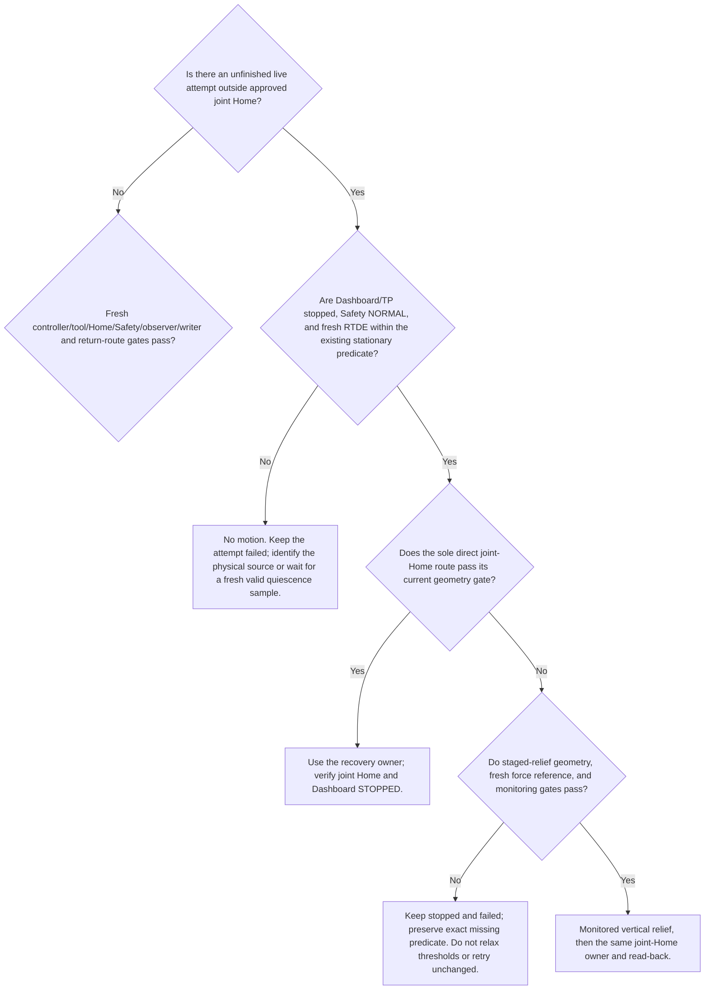

# TASE 5 N precision — binary decision tree

This is the active decision record for recovering and improving TASE-RNN 5 N normal-force accuracy. It keeps the short-EOAT RPSFC/SFC/DSFC drift experiment separate. Each failed attempt remains a failure and retains its original denominator.

```mermaid
flowchart TD
    A{"Fresh controller, short-EOAT installation/TCP/payload, approved joint Home, Safety, observer, one writer, fetched-back package, and verified return route?"}
    A -- No --> A0["No motion. Record the exact missing predicate; continue independent offline work."]
    A -- Yes --> A1{"Does the fresh TP enter PLAYING and echo current runtime identity 606006/31/618001 before timeout?"}
    A1 -- No --> A10["No ARM/contact/PATH. Preserve the first Load/Play failure, fresh read-back and Installation evidence; diagnose that exact package/runtime before another start attempt."]
    A1 -- Yes --> B{"State 20 contact search with current 8 mm early-brake package passes without force/travel/timing guard?"}
    B -- No --> B0["Recover to the same joint Home. Identify the first force/travel/speed condition; do not repeat the same failed branch unchanged."]
    B -- Yes --> C{"After the 8 s ramp, does the actual 0.5 s PATH-entry conjunction open?"}
    C -- No --> C0["Preserve the failed attempt and first failing conjunct. Replay force, freshness, TCP/joint stationarity, torque and Safety; do not call this a 10 s hold failure."]
    C -- Yes --> D{"Full 60 s PATH, 550/550 [5,60) bins, and all raw host/RTDE/Kunwei/TP-consumed layers >=460 Hz?"}
    D -- No --> D0["Keep any measured MAE as labeled diagnostic data; recover Home and inspect the first deficient layer or missing PATH interval."]
    D -- Yes --> E["Seal one A unit: Md=9.565272137974492, Bd=693.6559295653944, integral=1.0 N·s; report contact, 0–60 s, and formal [5,60) separately."]
    E --> F{"Does a second same-condition A unit reproduce the contact gate, rate floor, full path, and score range?"}
    F -- No --> F0["Keep both outcomes in the denominator; diagnose the first differing contact/timing/measurement factor before any controller comparison."]
    F -- Yes --> G{"Are per-frame normal error, integral, single/double saturation, actual q/qd, dt, host publish, RTDE and TP echo joined and complete?"}
    G -- No --> G0["Repair telemetry capture and validate it offline; do not infer windup from the terminal integral alone."]
    G -- Yes --> H{"Do force-frame/baseline/coordinate or sensing effects explain the error?"}
    H -- Yes --> H0["Correct only the demonstrated measurement/execution issue; KWR75 remains feedback, not independent task-force truth."]
    H -- No --> I{"Do integral growth, state/authority clamp, output saturation, slew, or rollback explain the error?"}
    I -- Yes --> I0["Compare one integral/anti-windup change at a time with path gains frozen and complete matched paths."]
    I -- No --> J{"Does a measured local second-order model fit the 5 N normal axis?"}
    J -- Yes --> J0["Estimate effective M, then compare zeta 0.5, 0.707 and 1.0 using either B=2*zeta*sqrt(M*K) or K=B^2/(4*zeta^2*M)."]
    J -- No --> J1["Report where the model fails and use a bounded independent normal K/B grid; do not reuse tangential Bd or stiffness."]
    J0 --> K{"Does TASE-QP pass the full-path, >=460 Hz, and frozen actual_qd >=0.900 gates?"}
    J1 --> K
    K -- No --> K0["Keep each QP attempt failed. Use exact consumed-sequence telemetry to localize command-to-target and target-to-actual mismatch; do not repeat unchanged."]
    K -- Yes --> K1{"Does eligible paired evidence support >=0.10 N improvement with 95% CI lower bound >0?"}
    K1 -- No --> K2["Keep A as incumbent; preserve the QP result and failure denominator."]
    K1 -- Yes --> K3["Record QP as a supported candidate; retain its exact numerical profile."]
    K0 --> L{"Is the R31 TASE+SFC live identity, tangent law, and final single qdot realization closed offline?"}
    K2 --> L
    K3 --> L
    L -- No --> L0["Continue same-input offline replay; do not infer a live composed method from model scores."]
    L -- Yes --> L1["Only then admit a bounded SFC+TASE live candidate through fresh gates."]
    L1 --> M{"Does a candidate pass 5 matched complete A/candidate pairs at >=460 Hz?"}
    M -- No --> M0["Retain failures and diagnose; allow up to 10 pairs only when the first five are near the evidence threshold."]
    M -- Yes --> N{"Mean MAE improvement >=0.10 N and paired 95% CI lower bound >0?"}
    N -- Yes --> N0["Report an evidenced improvement, with KWR75 truth limitation and the full failure denominator."]
    N -- No --> N1["Report no established improvement; retain A or the best supported method."]
    N0 --> O["Only after the archive/capacity gate: bounded online learning candidates between episodes, never inside the live real-time loop."]
    N1 --> O
```

## R31 QP observability update — 2026-09-26

The sealed QP command timelines now show numerical rank 6/6 for every PATH Jacobian row in both live QP attempts (29,995 and 29,956 rows; relative SVD threshold `1e-10`). Therefore the branch “change only the objective weights to smooth qdot” cannot change the exact full-rank `J qdot = twist` solution. If a hard bound conflicts with the equality, objective reweighting cannot make it feasible either. Keep both QP attempts failed at the original `actual_qd >= 0.900` gate; do not retry unchanged. Any next QP branch must explicitly change task/constraint structure and bring its numerical slack/dynamic profile for discussion before a live run. See `tase_r31_qp_equality_observability_20260926.md`.

## Historical branch position (checkpoint before R31 rate460)

The following section records the earlier September 25 checkpoint. The later
R31 rate460 A and TASE-QP observations are recorded below and supersede its
current-status statements; no earlier failure or metric is deleted.

- **Latest branch: A → Yes → A1 → No.** At 13:09 HKT the no-motion r27 start-check got Dashboard Load=`Loading program ... codex_eoat_probe_20260925_r2.installation` and Play=`Starting program`, but all 117 observed Dashboard snapshots stayed STOPPED and all 717 RTDE samples stayed `runtime_state=1`. No revision-27 TP identity was observed; only stale `(606006,25,618001)` / state90/reason58 registers appeared. They do not establish a new physical TP fault reason.
- The preceding formal A attempt also stopped before contact qualification and PATH with the same `PLAYING` timeout. Both attempts issued zero host motion commands; the second 10 s start-check issued no ARM or PATH. Joint Home and Dashboard STOPPED/Safety NORMAL were freshly verified. Neither run has a force MAE.
- Required video was available during the no-motion check; it did not trigger the failure. A digest-pinned isolated URSim test loaded the same r27 triplet and Installation. After its simulator-only power recovery, Dashboard acknowledged Play as `Starting program` but the TP stayed STOPPED with zero simulated motion. The simulator's `/ursim/URControl.log` recorded `Compile error: name 'abs' is not defined`; the fetched-back `.urp` cache exactly matches the `.script` and both contain `local vertical = abs(speed[2])`. The source helper `codex_r006_abs` already exists, so this is a concrete generated-URScript defect and a strong candidate explanation for the physical symptom. The real controller itself did not expose that compiler event; keep the physical causal link as **probable, not yet directly observed**. The code fix, r28 rebuild and isolated start check are pending before the next physical start. Evidence: `runs/tase-r27-start-check-20260925T1309HKT/ursim-r27-start-logprobe.json`, `runs/tase-r27-start-check-20260925T1309HKT/supervisor-result.json`, and `runs/tase-r27-baseline-prep-20260925T1329HKT/software_baseline_receipt.json`.

- Two live A units now completed full 60 s PATHs and 550 formal bins with fresh joint-Home and STOP evidence. Their formal bin-mean MAEs are **1.172493 N** and **1.269608 N** (mean 1.221050 N). With `n=2`, do not infer repeatability or treatment effect.
- State 20 passed on both attempts using the fresh 8 mm package. State 21's actual gate is the 8 s ramp followed by a distinct 0.5 s continuous `PathEntryReleaseGate`; there is no active 10 s hold. The old rate400 reason-48 failure held the complete predicate 0.267 s. The two successful A attempts held it **0.540 s** and **0.501621 s**. Keep the gate unchanged; the second pass had only 1.6 ms margin.
- The older runtime readiness counter and the later joint-release diagnostic remain historical receipt fields, not the current release rule.
- The second A's raw host/RTDE/TP echo/Kunwei rates were **499.2/499.1/480.0/999.98 Hz**. Every raw layer passed 460 Hz. The synchronized accepted-row rate was 480.0 Hz and is not a raw-layer frequency.
- The sealed v2 command trace is complete for all **29,950** rows. The 1.0 N·s integral state was at least 98% of its limit for **11.6%** of ticks; task-space saturation feedback was active on **30.6%** of ticks. These observed events motivate an offline anti-windup replay but do not prove causation. Final realization saturation and host slew each occurred on only 16 ticks.
- Timing met the rate floor but had a **19.674 ms** maximum host observation gap and **19.757 ms** publish gap. At the largest gap, measured provider and solver execution totalled about 1.26 ms, so those computations do not explain the full wait. Upstream cause is still unknown. Freshness passed by only about 0.33 ms.
- Same-input CPU/GPU replay on all **29,950** sealed rows produced a maximum command difference of `4.62e-9 rad/s`. CPU median solve time was **0.0525 ms**, GPU **0.0671 ms**. GPU therefore does not explain or fix the long host gaps; live backend remains CPU.
- The sensor frame counter confirms **999.98 parsed Kunwei frames/s**, but the transport returns only the newest wrench from each batch. The host consumes/publishes at about **499 Hz**, and the sealed JSON trace does not retain all values in the 1 kHz batches. There is no evidence yet that 1 kHz input improves filtering or force estimates.
- The fixed-error integral replay exactly reproduced A's 1.0 N·s state. It places B's 0.5 N·s legacy cap at mean absolute state **0.278 N·s** versus A's **0.594 N·s**. The conditional/double-clamp D replay had **0.388 N·s**, but reused A's saturation signs and did not recompute D's outputs. None of these fixed-input replays estimates force MAE.
- The natural-excitation model audit from both A paths did not identify a valid local 5 N second-order model: K-only force/position `R²` was about **0.002–0.005**, and K/B/M values changed sign or scale with smoothing and PATH half. Do not derive zeta values from that fit. Keep an independently named K/B grid offline until a local model or discussed live candidates exist.
- Current next offline branch: prepare a bounded local identification protocol and assess sensor-batch retention needs. First live integral comparison, when the candidate/recovery gates are fresh, is A versus B with every other parameter frozen; D stays offline until its final-output feedback is recomputed from D commands.
- Continue with offline scheduler/communication attribution and CPU/GPU solver benchmarking while no live writer exists. Keep Kunwei's ~1 kHz acquisition distinct from the 500 Hz controller/460 Hz acceptance layers. Next live methods remain gated on explaining the measured trace and validating each one-factor candidate offline.
- A/Candidate confirmation requires full 60 s, each required raw layer >=460 Hz, mean MAE improvement >=0.10 N, and paired 95% CI lower bound >0. Failures remain in the denominator. KWR75 feedback is not independent task-force truth.

## R31 rate460 and TASE-QP branch — 16:15 HKT

- Fresh current R31 A attempts at 15:10 and 15:30 HKT both completed 60.0 s,
  550/550 formal bins, passed the 460 Hz timing gate, and returned to verified
  joint Home with Dashboard STOP. Formal MAE was **1.282720 N** and
  **1.006797 N**. The two values are descriptive with n=2; neither establishes
  a treatment effect. Their trace comparison remains in
  `reports/tase_r31_a_repeat_trace_comparison_20260925.json`.
- The requested short TASE-QP scheduler attribution replayed one sealed
  35-iteration input 30,000 times with live-writer-style GC disabled. Solver
  time median was **0.03195 ms**, maximum **0.04601 ms**; zero solves exceeded
  the frozen **1 ms** deadline. The prior **106.1 ms** event was not reproduced
  and remains unexplained. The earlier 1.4–1.5 ms probe spikes were caused by
  the diagnostic harness with GC enabled and per-sample object allocation;
  retain that run as a harness artifact, not controller evidence.
- First rate460 TASE-QP attempt used the previously frozen BO-10/B profile
  (`Md=8.592660`, `Bd=772.147372`, integral **0.5 N·s**). It executed a complete
  **60.006 s** PATH with 550 bins, timing passed at **481.1 Hz** effective
  writer/echo rate, and all **29,997** QP solves passed (maximum **0.0926 ms**).
  It was ineligible because published-versus-actual joint-velocity
  correlation was **0.840132 < 0.900**. Its **0.914710 N** MAE is diagnostic,
  not a formal controller score. Recovery verified joint Home and STOP.
- A matched rate460 QP attempt then held the R31 A outer profile fixed
  (`Md=9.565272`, `Bd=693.655930`, integral **1.0 N·s**) and changed only the
  inner solver. It completed **60.004 s**, 550 bins, and passed timing at
  **480.05 Hz**; all **29,957** QP solves passed with maximum **0.1001 ms**.
  Its motion gate still failed at correlation **0.848607 < 0.900**. The
  **0.950139 N** MAE is diagnostic only. The exact same-consumed-packet replay
  reproduced **0.848627**; shifting the association by one packet reached only
  **0.852176**. Joints 2, 4, and 5 correlations were **0.705**, **0.880**, and
  **0.086**, respectively. The two RNN A controls passed the same gate at
  **0.9701** and **0.9721**. This is a matched live method observation, but the
  QP attempt remains a failure because actual-velocity tracking did not meet
  the frozen gate.
- Neither QP attempt had a safety, Home, frequency, or solver-deadline failure.
  Do not relax the **0.900** motion gate or report either diagnostic MAE as an
  eligible BO observation. Both failed attempts remain in the denominator.
- The second QP setup failure (`TASE_QP requires the sealed bo-10 candidate
  identity`) occurred before ARM or host motion publication; it is preserved
  separately. The live writer now accepts exactly the prior BO-10/B profile
  or the rate460 R31-A profile for a matched solver comparison. All other
  candidate identities and altered values remain rejected before Dashboard
  Load/Play.
- Next: complete offline per-joint command/actual-velocity diagnosis and the
  SFC+TASE composition replay. Keep SFC gains and the final joint-velocity
  realization fixed to their approved records. No SFC+TASE live run is inferred
  from this QP result.

## Historical recovery decision branch — 09:30 HKT

While a prior live attempt is outside joint Home, recovery precedes the next experiment:

The current event is at **S → No**. Fresh preflight showed Dashboard STOPPED and Safety NORMAL, but a 5.01 s RTDE capture had only 17.3% frames passing the exact stationarity predicate and a longest continuous pass of 9.5 ms. The corrected recovery owner therefore dispatched no motion. The first invocation's missing `AMENT_PREFIX_PATH` was fixed; the next owner invocation reached and failed the actual stationarity check. Do not invoke it again unchanged. Resume only after the physical condition changes or new evidence supports a different safe recovery diagnosis. The stale baseline recaptured below the Home clearance height is not accepted as no-contact evidence.

The first integral pair is incomplete: B (`0.5 N·s`) is one eligible full-path observation at **1.272056 N** formal MAE and **465.783 Hz** minimum rate layer with verified Home; subsequent A (`1.0 N·s`) reached 60.002 s / 29,954 formal command rows but TP stopped at `reason=58 return_guard=0`, with no certified path completion or Home. Keep that A attempt failed and do not report a paired integral comparison.

The latest TP read-back narrows A's failure: the 60 s formal PATH ended and emitted `state=40`; the subsequent 250 ms stationary dwell failed with reason 58 before any return guard was set. The TP's own fault path then retried the same bounded return but could not establish its stationary start condition. Do not classify this as a State-20/21 contact-release failure or an integral-policy result. The separate host recovery's current stationarity gate also remains unmet.

A sealed v2 timeline may still support labeled diagnostics when a failed receipt omits its PATH start. The reducer now infers only the clock origin from `host_monotonic_s - reference_time_s`; it does not synthesize lifecycle completion, Home, eligibility, or an official score. Focused reducer tests pass 2/2.

## Checkpoint — 16:54 HKT (superseded by the 17:35 update below)

- **Power state:** fresh read-only preflight confirms the robot is already powered, Safety NORMAL, TP STOPPED, and within `2.9e-5 rad` of the approved joint Home. No Power On command or motion was sent.
- **TASE-QP:** both 60 s attempts still fail the frozen `actual_qd` correlation threshold `0.900`; measured values are `0.840132` and `0.848607`. Keep them as failures and do not rerun unchanged.
- **SFC/DSFC:** the R31-parameter-aligned offline proxy is complete (30/30, five blocks × three scenarios × two laws). Under the proxy, mean paired DSFC-minus-SFC model MAE is `+0.0000021 N` on plane, `+0.0003143 N` on tangent pulse, and `+0.0082936 N` on normal pulse. This is not a physical outcome. The `120 N/m` path-stiffness setting remains a model-only value, and no live composed method is registered.
- **Next branch:** resolve the QP joint-velocity mismatch and prepare a separately reviewed live SFC+TASE identity/parameter binding; keep the motion gate unchanged.

## QP motion mismatch follow-up — 2026-09-25T17:01:55+08:00

- A wider ±24-packet scan did not reveal a causal lag repair: the best flattened QP correlation was `0.852176` at offset `−1` (future command), and J2/J4 peaks remained `0.709` / `0.889`.
- The QP sealed command trace has higher J2/J4 setpoint-change rates and more host slew / output-feedback realization-limit flags than either RNN baseline. This is a plausible proximal mechanism, not proven root cause.
- Keep live QP stopped at the failed eligibility branch. Next offline work: relate QP active-set changes and final `Jqdot` shortfall to subsequent RTDE qd rows. Do not relax the `0.900` threshold or repeat the same live profile.

## Event-conditioned QP follow-up — 2026-09-25T17:07:30+08:00

- The output flags alone do not explain the QP miss: RNN A flagged-row correlations are `0.978/0.981`, but matched QP flagged rows are `0.801`; its unflagged rows are `0.907`.
- Continue with same-row, same-sequence inspection of requested twist, final published `Jqdot`, active constraints and RTDE actual qd. Treat this as an association to diagnose, not a causal result. No physical rerun or gate relaxation.

## QP setpoint-transition discriminator — 2026-09-25T17:11+08:00 HKT

- Within QP, task-space-output-changed rows have larger J2/J4 setpoint-change rates than its no-flag rows; the same flags do not make the RNN A setpoints jagged. This points to a method-specific command/output interaction.
- Root cause remains unresolved. Next inspect each flagged sequence's requested twist, final Jqdot, constraints, and following RTDE qd; do not change the frozen QP profile or live gate.

## QP task-only residual check — 2026-09-25T17:12:54+08:00

- QP task-only flagged rows have near-zero provider task-normal versus final Jqdot normal residual, but only 0.795 actual_qd correlation. RNN task-flagged rows stay at 0.978/0.981. This narrows the discrepancy to QP command/robot tracking behavior in those episodes, without proving a cause.
- Continue by inspecting the exact per-row joint command transitions and measured qd; preserve the complete official sample set and the 0.900 gate.

## QP row-linkage checkpoint — 2026-09-25T17:15:54+08:00

- QP flagged J2/J4 rows have much larger same-sequence qdot tracking RMSE than RNN A under matching flags; one-sample delay only partly improves QP.
- Error magnitude covaries with QP setpoint-change rate. Treat this as a narrowed diagnostic hypothesis, not a confirmed physical root cause.
- Next offline task: inspect command transition / final Jqdot shortfall rows and distinguish solver mapping from host-output bounds and robot servo behavior. No live retry until that evidence changes the hypothesis.

## Current branch — 2026-09-25T18:01+08:00 HKT

- The user asked to power on and continue. Fresh read-only status already showed the robot powered; no Power On command was sent. Safety was NORMAL, controller remote, TP STOPPED, short EOAT binding unchanged, Kunwei reachable, and no writer process present.
- A 10 s resident no-motion start-check passed with 1,000 RTDE frames and no ARM/PATH or motion. `required` video preparation then stalled before dispatch and produced a terminal no-dispatch receipt. The previously approved `evidence-only` route passed with usable video, and the subsequent A run also sealed available video.
- R31 A3 completed an eligible 60.0 s PATH and 550 formal bins: MAE **1.017505 N**, effective rate **480.567 Hz**, official `qd` correlation **0.967947**, and verified joint Home. The three eligible R31 A MAEs are **1.282720, 1.006797, and 1.017505 N** (mean **1.102341 N**, sample SD **0.156304 N**). Descriptive only; no treatment conclusion.
- The sealed matched-QP exact-sequence diagnostic now separates two telemetry stages. Relative to RNN A, QP correlation is already lower from host command to RTDE target qd (J2/J4/J5: `0.971/0.973/0.661`) and falls further from target to actual qd (`0.710/0.890/0.052`). The clearest QP-specific amplitude/error contrast is J2/J4: actual qd standard deviations are `0.00794/0.00851 rad/s` versus RNN A3 `0.00228/0.00305`, and target-to-actual RMSE relative to command standard deviation is `1.44/1.01` versus `0.56/0.36`. J5 correlation is weak in A as well because its command variation is small. QP's `J·command` versus RTDE linear speed correlation is `0.783` with `0.001643 m/s` RMSE; RNN A repeats are `0.958–0.969` with `0.000475–0.000560 m/s` RMSE. The QP attempt remains failed at the frozen **0.900** gate despite its complete PATH, passing timing and `0.950139 N` diagnostic MAE. No root cause is confirmed and no QP profile or threshold was changed.
- Source inspection shows the deployed native QP minimizes `0.5||qdot||^2` under `Jqdot=twist` and box limits, with no previous-command term; a shared same-direction slew rescale runs after the solve. QP slew flags occur on 513/29,956 rows versus 7/29,778 for A1 and 3/29,991 for A2. This is a concrete mechanism candidate consistent with the QP-specific J2/J4 variation, not a confirmed root. Next offline step is an exact frozen-profile replay that records both pre-slew QP output and final published qdot. Do not add a continuity term or change its numerical value for live use without a separate discussion.
- `J·actual_qd` matches recorded RTDE `actual_TCP_speed` to numerical precision in these streams. This is a telemetry/kinematic consistency check, not an independent measurement or physical-force truth.
- The exact 29,956-row frozen-input replay now reproduces the matched QP command plus post-solve host slew: all rows solved, all 513 slew-limited rows reproduced, and final qdot differs from the sealed publish by at most `1.224e-5 rad/s`. Slew can introduce up to `0.001640 m/s` Cartesian task residual after the QP equality solve. This confirms command reconstruction, not the physical cause of the actual-qd gate miss.
- The strict hard-equality QP with the existing per-joint slew envelope was independently infeasible at the first PATH tick (sequence 9676, `t=0`, `dt=2.2147 ms`, captured slew delta `0.00553669 rad/s`): OSQP status 3 and a separate HiGHS linear feasibility check both agree. The live shared-scalar slew used `0.588094` and incurred `0.00163985 m/s` task residual on that row. This is a formulation conflict, not authorization to relax either bound.
- Keep the failed QP runs and frozen profile unchanged. Continue the SFC+TASE branch offline: the aligned model proxy exists, but has no physical status and the live registry has no composed entry. Do not move to live composition until its exact method identity, normal/path inputs, numeric profile and return route are closed and discussed.
- At 17:55:37 HKT, a fresh read-only preflight verified program STOPPED, Safety NORMAL, zero TCP speed, approved joint Home within 3.3e-5 rad, unchanged short-EOAT Installation, Kunwei reachability, and no live writer/bridge. Evidence and reducer are in `reports/tase_r31_cartesian_velocity_diagnostic_20260925.md` and the matching JSON.

## QP target-to-actual timing branch — 2026-09-25T23:20+08:00

- The exact-consumed-row `target_qd → actual_qd` scan across ±24 joined rows does not improve either QP episode: BO-10 is best at 0 ms (`r=0.840435`), matched-A is best at 0 ms (`r=0.851428`). The RNN A3 comparison changes only from `0.967183` at 0 ms to `0.968327` at +4 ms.
- **Timing-offset branch: not supported as the QP gate repair.** Do not shift sample joins or substitute this telemetry correlation for the frozen published-qdot/actual-qdot gate.
- **Continue at output dynamics:** compare QP setpoint transitions and realization flags with subsequent RTDE target and actual velocities on the exact sequence. Keep the 0.900 gate, BO-10 profile, integral policy, and failed-attempt denominator unchanged. No live QP retry until new replay evidence or a materially different, reviewed solver formulation exists.
- Receipt: `reports/tase_r31_target_actual_qd_lag_20260925.json`; focused test checks lag sign and controller timestamp monotonicity.

## Current checkpoint — 2026-09-25, 22:25 HKT

- **R31 A→E confirmation:** complete, 5/5 valid pairs. A averaged 0.987131 N and E 1.748434 N; paired A-minus-E was −0.761304 N (95% CI [−0.893456, −0.629151] N). Retain the 7 failed physical attempts; no E improvement is supported.
- **TASE-QP:** both frozen-profile live attempts remain failed at the 0.900 actual-qd correlation gate. No same-profile retry; continue only the SFC+TASE offline branch and keep all new live numerical choices explicit.
- **SFC+TASE:** R31-aligned five-block model proxy is complete (30/30) but has no physical evidence. The 120 N/m path-stiffness default is not live-approved, and no combined live method is registered. Current branch is `L → No`; finish the bound tangent/path profile and executable single-realization seam offline before requesting any composed live admission.
- **Bench:** robot already powered, approved joint Home verified after the last pair, Safety NORMAL, TP STOPPED, no writer/bridge. No redundant Power On was sent.

## Live continuation gate — 2026-09-25, 22:31 HKT

- A fresh read-only preflight after the Power On request again found `Robotmode: RUNNING`, Remote Control, Safety NORMAL, TP STOPPED, zero RTDE TCP speed, and the approved joint Home within `2.69e-5 rad`. Kunwei connect-only passed. No Power On command or motion was sent because the controller was already powered. Full snapshot: `runs/poweron-continue-preflight-20260925T2230HKT/preflight_readonly.json`.
- Continue the approved SFC+TASE branch offline until its live method is bound. The offline adapter uses `F_restore = -K_path P_t (x - x_ref)` with `K_path=120 N/m`; that value is model-only. The frozen native SFC coefficients are identifiable, but their historical receipt does not qualify the new composition. Do not launch the combined controller until `K_path`, tangent command bounds, exact method identity, one-realization integration, package read-back, and recovery path are sealed.
- At the existing valid R31-A path error (`XY p95=0.11144 mm`, max `0.44051 mm`), 120 N/m would contribute only about `0.0134 N` p95 / `0.0529 N` max to the offline tangent restoring input. In the 0.6 N tangent-pulse model proxy, the SFC path RMS was `2.489 mm`, or about `0.299 N` under that same gain. These are a baseline post-hoc calculation and a synthetic model result, respectively; neither predicts nor qualifies live SFC+TASE. Use them only to discuss the still-unapproved `K_path`.

## Normal-axis M/K/B checkpoint — 2026-09-25, 22:50 HKT

- Fresh RTDE read-back included the active payload inertia; a no-motion URDF/Pinocchio calculation at actual Home, using the source-matched calibrated model, gives normal operational mass **3.529 kg** with other axes free and **23.982 kg** with tangent/orientation acceleration constrained. These differ by task constraints and are not an empirical range or contact-model fit. Do not substitute TASE `Md`.
- The passive R31-A force/position regression remains invalid for empirical M/K/B. Environment `K_e/D_e` and closed-loop response are not identified. Continue to a fixed-XY, persistent normal excitation protocol with fresh sample/raw timing and current protection unchanged; choose its amplitude/frequency offline before any live capture. Do not derive `zeta` numbers yet.
- Receipt: `runs/tase-normal-axis-operational-inertia-model-candidate-v2-20260925T2252HKT.json`; analysis entry point and focused formula tests are `tools/analyze_tase_normal_axis_effective_mass.py` and `tests/test_tase_normal_axis_effective_mass.py`.

## Power-on continuation and provenance checkpoint — 2026-09-25, 23:35 HKT

- Fresh read-only preflight: already powered, Remote Control, Safety NORMAL, TP STOPPED, zero sampled TCP speed, and actual joints within `2.885e-5 rad` of the approved joint Home. This was one sample, not a new stationary-dwell verification. Short-EOAT payload/CoG/TCP matched the current binding. UR RTDE TCP-force norm read `1.062 N`; it is not Kunwei evidence and does not establish contact. Kunwei was connect-only; no force baseline, observer check, or motion was performed. Full snapshot: `runs/tase-poweron-continue-preflight-20260925T2333HKT/preflight_readonly.json`.
- No writer/bridge process or OS lock holder was observed. The shared `live-writer.lock` text still says `pid=862536`; that PID is absent, and the marker was preserved rather than manually deleted.
- The sealed R31 SFC/DSFC 30-attempt proxy is verified against the canonical rate460 A profile (all rows and trace hashes pass). The generic profile loader is fixed and now rejects the neighboring rate400/0.1 profile; regression tests: 11 passed. Receipt: `reports/tase_sfc_dsfc_r31_profile_provenance_audit_20260925.json`.
- Decision stays `TASE-QP: failed, no unchanged retry` and `SFC+TASE: offline only`. The `K_path=120 N/m` value remains unapproved for live use. Continue offline analysis; no new robot motion is admitted by this status check.

## R31-aligned SFC/DSFC replay checkpoint — 2026-09-26, 00:17 HKT

- Preserve the first completed command replay as profile-mismatch evidence: it used generic RNN `epsilon=0.014/r=0.2`, so it is not an R31 A replay even though its A outer-loop values and identical-input pairs match. The loader was corrected to require the R31 A method identity and `epsilon=0.022/r=1.0/minus`.
- Correct replay: **15/15 same-input units, 30/30 controller replays**. All candidates bind R31 A normal/outer profiles; all pair digests match; one final realization per tick; no joint speed bound violations; tangent-to-normal leakage `<1e-12 m/s`. Tangent-command RMS differences are descriptive only: plane `DSFC−SFC=-0.0035 mm/s`, tangent pulse `+0.122 mm/s`, normal pulse `+0.102 mm/s`. The replay has no physical force or motion outcome.
- Corrected historical audit finds 89 TASE run directories and 228 sensor/RTDE/published-packet streams; required consumed normal/reference/Jacobian/bounds inputs are missing, so historical physical traces cannot support byte-identical alternate-controller replay. See `reports/tase_sfc_dsfc_historical_trace_schema_audit_20260926.json`.
- Branch remains `SFC+TASE: offline only`; `K_path=120 N/m` is not live-approved. No QP retry or new motion was issued. Latest Dashboard/RTDE-only evidence is `runs/tase-poweron-continue-preflight-20260926T0017HKT/preflight_readonly.json`.

## QP frequency-response diagnostic checkpoint — 2026-09-26

- A sealed exact-sequence spectral diagnostic attempted conventional Welch analysis. Each 60 s attempt had 1,135–1,397 continuous RTDE spans, but the longest was only 40–53 samples (80–106 ms); all were shorter than the required 1,024-sample window. No spectral result was generated and no missing rows were interpolated.
- Conclusion: standard Welch is ineligible on the current frame sequence. This does not identify a physical QP cause. Keep the original 0.900 gate and failed attempt classifications; do not shift the join or rerun the frozen profile unchanged.
- Existing time-domain evidence remains the usable QP branch: same-row lag scan has no corrective offset; QP J2/J4 setpoint-change rates are much higher than RNN A; event-conditioned qd association is descriptive, not causal. A timestamp-aware irregular-sample estimator is a distinct diagnostic and must be validated offline before use.
- Receipt: `reports/tase_r31_qd_frequency_response_20260926.json`; readable feasibility note: `reports/tase_r31_qd_frequency_response_feasibility_20260926.md`.

## Rate460 A continuation checkpoint — 2026-09-26, 01:51 HKT

- The powered-on continuation first preserved one CPU-6 failure as a partial-path diagnostic; it was returned to the approved joint Home by the existing recovery owner. Three earlier rate460 A baselines were already complete, so no force MAE was fabricated from the failed run.
- A targeted repeat used control CPU 4, matching earlier eligible A runs, and added a low-overhead thread-CPU timing probe to the host. The full 60 s PATH completed with 550/550 bins and formal MAE **1.101940 N**. Across four complete same-protocol A units, the descriptive mean is **1.102240 N** (sample SD **0.127623 N**); this is not a treatment comparison.
- All raw protocol layers passed 460 Hz: host reference/publish 500.033/500.083, RTDE 499.967, TP-consumed formal echoes 481.083, Kunwei 999.967 Hz. Provider maximum wall time was 1.209 ms, with no call over 2 ms; final receipt reports Dashboard STOPPED, normal TP STOP reason 4, verified stationary joint Home, and available video.
- Prior CPU-6 evidence: 23.42 ms writer RTDE interval, 23.82 ms publish gap, and a 22.505 ms provider call with 0.070 ms RNN solver time. The CPU-4 success is consistent with the successful historical A runs but does not prove affinity was causal; the timing probe is another host-side difference. Keep the threshold unchanged. Fresh failed and successful receipts are in `reports/tase_r013_rate460_cpu4_live_repeat_20260926.md`.
- The successful trace contains 30,002 formal per-frame rows; the integral state was at/above 98% of the 1.0 N·s limit on 9.78% of those rows. Treat this as a reason to compare integral policies, not proof of windup causality. Continue at the `G → Yes` telemetry node and keep sensor-feedback metrics distinct from independent task-force truth.

## Rate460 integral pair 02 — 2026-09-26

- The controller was already `RUNNING`; no Power On command was needed. Fresh start-check verified remote mode, Safety NORMAL, stationary approved joint Home, matching short-EOAT values, and video. The randomized resident order was B (0.5 N·s) → A (1.0 N·s).
- B completed 60 s / 550 bins at 499.80 Hz host+RTDE, 480.77 Hz TP echo, and 999.98 Hz Kunwei; MAE was 1.186203 N, Home verified, next-attempt ready.
- A completed 60 s / 550 bins and Home, with diagnostic MAE 1.020614 N, but host+RTDE fell to 429.15 Hz and TP echo to 376.62 Hz. The strict 460 Hz gate failed; do not admit this MAE or calculate a paired difference. The whole pair is incomplete.
- A's tick interval was p95 4.027 ms, while publish latency was p95 1.653 ms and provider compute max 1.540 ms with no call over 2 ms. The scheduler recorded 2,525 missed 2 ms slots. This localizes the observed deficit to between host ticks; it does not yet identify the scheduler, RTDE-frame availability, or other source.
- Terminal state: Dashboard program STOPPED, Safety NORMAL, powered, joint Home error `5.48e-5 rad`, no writer/bridge. Reused turnaround was 85.20 s, still above the 81 s engineering target. Preserve all raw traces and the failed eligibility denominator. Before another pair, expose per-poll RTDE readiness/drain and wall/thread timings to distinguish frame availability from host-loop delay; keep the 460 Hz threshold unchanged.
- Detailed evidence: [pair 02 report](tase_integral_pair02_rate460_20260926.md), [sealed resident run](../runs/figure8-20260925T180605-892740/), and [randomized plan](../runs/tase-integral-ab-pair02-rate460-20260926/pair-plan.json).

## Rate460 integral pair 03 — 2026-09-26

- A fresh no-motion start-check passed; the controller was already powered, at the approved joint Home, Safety NORMAL, and video was available. One resident session then completed a randomized B (0.5 N·s) → A (1.0 N·s) pair.
- Both arms passed the complete 60 s / 550-bin PATH and 460 Hz timing gate. TP-consumed rates were 480.87 Hz (B) and 480.27 Hz (A). Formal MAEs were 1.163210 N (B) and 1.089792 N (A), so this one-pair difference does not support a treatment conclusion.
- Per-poll telemetry shows all polls ready, no poll or receive call above 2 ms, provider maximum 1.410/1.471 ms, and occasional PATH host gaps up to 10.23/12.06 ms. The long intervals are outside the measured solver/provider/receive work; exact scheduling versus frame-arrival cause remains unresolved. Keep 460 Hz; this pair does not support 400 Hz.
- State 20 lasted 9.428–9.450 s and state 21 lasted 8.866–8.984 s. Total through-seal times were 85.38 s cold and 85.68 s reused; the ordinary reused cycle remains above the 81 s target.
- Per-cycle KWR75 feedback shows about 19.38% below 1 N in both arms and larger instantaneous sample error than the formal bin-mean MAE. This remains sensor-feedback evidence, not independent task-force truth. No integral effect is established.
- Both attempts sealed with verified stationary joint Home; Dashboard ended powered, Safety NORMAL, program STOPPED, and no writer/bridge remained. Full report: [pair 03](tase_integral_pair03_rate460_20260926.md); [sealed run](../runs/figure8-20260925T183553-898491/).
- **Next:** continue randomized complete A/B pairs to five eligible pairs; keep failed units in the denominator, do not stitch pair 02's failed A, preserve the 460 Hz gate, and investigate the measured state-20/state-21 dwell and long inter-tick intervals from the new aligned receipts.

## R31 rate400 resident timing follow-up — 2026-09-26, 06:14–06:23 HKT

- The user requested Power On and continuation. Fresh Dashboard already reported Remote Control, `Robotmode: RUNNING`, Safety NORMAL and program STOPPED, so no Power On command was sent. The sole resident owner then completed six units in one session. This is a separate `r013_60_rate400` protocol; do not relabel or pool it as a rate460 campaign.
- All six attempts were eligible, each completed exactly 60.000 s and 550/550 formal `[5,60)` bins, returned to joint Home, and was ready for the next attempt. The randomized order was cold, three ordinary reuse units, one real 300 s preparation refresh, then reuse. KWR75 normal-feedback MAEs were **0.955784, 1.119653, 1.072852, 1.119570, 0.916966, 1.085349 N** (descriptive mean **1.045029 N**, sample SD **0.087051 N**; not a treatment effect or independent task-force truth).
- TP-consumed rates were **481.03, 481.18, 478.93, 481.08, 481.12, 480.38 Hz**; host/RTDE were **497.97–499.98 Hz**, Kunwei **999.97–999.98 Hz**. All passed the rate400 gate. Although the measured TP values happened to exceed 460 Hz, the bound protocol remains rate400, so this does not promote the attempts to rate460 evidence or pair them with rate460 units.
- Full through-seal times were **85.079 s cold, 90.048 s reuse, 84.968 s reuse, 85.122 s reuse, 98.200 s refresh, and 85.805 s reuse**. The four ordinary reuse values have median **85.464 s**, missing the `<=85 s` target by **0.464 s**. Keep cold and refresh separate. Do not claim the infrastructure time gate passed or start the planned integral screening yet.
- Phase attribution narrows the time variance. State21 was **8.856–8.860 s** and the state25 path stage **61.014–61.018 s** across all units. Attempt 2's state20 lasted **14.388 s** versus **9.312–9.402 s** in the other reusable units; its corrected KWR75 force-vector norm stayed near **0.21–0.23 N** through most of the dwell and rose to contact-range values only near the end. The same attempt's TCP Z reached 10 mm below its start at 7.634 s and 13 mm below at 12.908 s, versus about 2.6 s and 8.0 s in the other reusable attempts. This is evidence of delayed contact acquisition, not a confirmed physical root cause; the corrected wrench norm is not the signed normal-force metric. Attempt 6's state40 return took **4.282 s** versus **3.560–3.670 s** for the other units, contributing most of its excess over the faster reused cycles.
- The new bounded hot-path telemetry sealed all six times: stage-pair duplicate/unmatched counts were zero; state25 control-step mean was **1.135–1.160 ms** (maximum **2.054 ms**); RTDE poll wall maximum **0.853–1.658 ms**; RTDE socket-sendall maximum **0.023–0.032 ms**. These measurements do not show a provider/socket bottleneck. RTDE timestamp gaps over 4 ms and occasional 18–20 ms poll gaps remain in the traces; no scheduler/frame-arrival root cause is declared.
- Video was recorded with the approved `evidence-only` policy. The sealed receipt has `available=true`, `error=null`; ffprobe reads 720×1280 H.264 at 30000/1001 fps, **16,100 frames / 537.145 s**. A preceding `required` preparation attempt remains preserved as terminal-no-dispatch after the recorder's two-second file-growth check; it issued no motion. Do not call that software capture failure a physical blocker.
- Final fresh read-back: Dashboard program STOPPED, Safety NORMAL, robot still powered; 12 RTDE samples over **1.1 s** stayed within **0.000064 rad** of approved joint Home, with peak absolute `actual_qd` and TCP speed about **0.000013**. No writer, bridge, ffmpeg recorder or global lock holder remained. EOAT read-back was payload **0.413 kg**, CoG `[0.0011,0.0031,0.0163] m`, TCP `[0,0,0.0874,0,0,0] m/rad`.
- Receipts and raw traces are in `../runs/tase-r31-rate400-insttiming-infra-20260926T0635HKT/`. The directory suffix was allocated as `0635HKT`; immutable receipt timestamps are authoritative and record the actual run from **06:14:34 to 06:23:25 HKT**.
- Focused writer-loop tests passed **9/9**. The first broader four-file run reported 76 passed and two failures: one run lacked `AMENT_PREFIX_PATH`, and the synthetic CPU/RTDE peer-service test saw its socket close during concurrent CPU work. With the ROS environment set, the peer-service test passed in isolation. The remaining offline fixture assertion expects `packet_evidence_enter` and `scheduler_enter` marks that its simulated fixture does not emit. Do not report the broad suite as fully green.
- **Current branch:** the fresh rate400 six-unit path and Home evidence pass; the ordinary-turnaround objective does not. Continue offline attribution of state20 contact-latch delay and state40/final-seal overlap before another physical campaign. Preserve the rate400 protocol identity, 400 Hz floor, force/speed protections, path duration and readiness dwell; do not shorten the PATH or change success labels.

## Rate460 R013 terminal-boundary repair — 2026-09-26, 15:07 HKT

- The robot was already powered and stopped at the approved joint Home; no Power On command or motion was sent for this continuation.
- Pair11 replacement01-B remains an **ineligible failed attempt**. Its finalizer reported `59.996 s = 59.994 s observed physical span + 0.002 s median interval`, four milliseconds short of the frozen 60 s requirement. The original receipt remains unchanged. The supervisor verified fresh Dashboard STOPPED, Safety NORMAL, stationary RTDE and joint Home; no recovery motion was needed because Home was already reached.
- Trace join identifies the first consumed formal PATH echo at TP sequence **94663**, controller time **176088.363 s**, reference time **0.000 s**. The old latest-only boundary was about **176088.373 s**, inferred from the final `176148.367 s` path sample and the receipt's `59.994 s` physical span: approximately 10 ms late.
- At the end, the trace records TP state **40 / RETURNING**, consumed sequence **124645**, RTDE time **176148.371 s**; the provider's last formal clock is **60.002 s**. From the first formal echo, the controller interval to RETURNING is **60.008 s**. The TP source emits state 40 before `stopj` and joint Home motion.
- The host now retains a bounded list of timestamps and consumed-packet echoes from each drained RTDE batch, then binds PATH start to the first formally tagged echo. An incomplete or overflowed batch fails closed. For R013, a state-40 endpoint receipt proves 60 s only when both the consumed PATH reference and RTDE span from the first echo are at least 60.000 s. The RETURNING frame adds no force or motion sample; formal force MAE remains based only on `[5,60)` and its 550 bins. The unsampled tail is kept separate in the receipt, and shorter intervals remain failures.
- Offline replay plus focused transport, boundary, collector and writer-loop checks: **32 passed**. This repairs the identified finalizer path but does not retroactively promote the original failed attempt or establish a new live eligible result.
- A fresh resident **no-motion** start-check then passed under the approved `evidence-only` capture policy: 10 s, 1,000 RTDE frames, zero ARM/PATH and supervisor motion commands, joint Home/stationarity, short-EOAT values, Safety NORMAL, Remote Control and video file available; Dashboard ended STOPPED. A preceding `required` capture preparation stopped because the recording file did not advance; it has a terminal no-dispatch receipt and no motion. This is recorded as a capture-path issue, not a robot blocker.
- **Next:** preserve the failed pair11-B record and run a complete pair11 replacement (B then A), then finish pair12 (A then B), through one resident writer. Recheck the patched RETURNING receipt, formal `[5,60)` bins, 460 Hz gate, final joint Home and all attempt denominators.

## Rate460 consumed-echo count correction — 2026-09-26, 15:10–15:16 HKT

- The four planned pair11/pair12 units completed one resident session. Every unit had 550/550 formal bins, a complete 60 s PATH, motion/home evidence, and an available evidence-only video. Formal normal-feedback MAEs were pair11 B/A **1.335414 / 1.016333 N** and pair12 A/B **1.030909 / 1.139554 N**. Two pairs are descriptive only; they do not establish an integral effect.
- Attempt `0003` was originally sealed `evidence_eligible=false` because the live counter reported TP echo **443.745 Hz**. Raw receive batches were complete in every row with no overflow (maximum batch size 6). Mapping each drained frame's consumed packet sequence to the sealed command timeline shows **468.617 Hz** distinct TP-consumed PATH echoes over the formal PATH interval; the same trace has **500.083 Hz** RTDE frames and **485.050 Hz** published PATH packets. Its TP echo inter-event p99/max are recorded in the supplementary JSON. The apparent miss came from counting only the newest echo per host tick and dividing by the longer first-echo-to-RETURNING interval, which includes about 1.9 s of terminal handshake after the formal 60 s window.
- A supplemental replay applies the same 460 Hz floor to every attempt using complete drained RTDE frames and `path_observed_span_s + path_coverage_interval_s` as the active PATH duration. All four satisfy the corrected layer-rate calculation. **The original receipts and their eligibility flags remain unchanged**; the third attempt is annotated by this separate analysis, not rewritten as an original pass. Do not mix the supplemental result with `rate400` data.
- The live writer now counts every complete drained frame/consumed-sequence pair and uses the formal active PATH span for R013 rate denominators; force scoring remains `[5,60)` and all protections and the 460 Hz threshold remain unchanged. Focused evidence, boundary, and raw-batch replay tests: **25 passed**. This code path has not yet been revalidated in a new live receipt.
- Source reanalysis and file digests: `reports/tase_r31_rate460_raw_echo_reanalysis_20260926.json`. Run: `runs/tase-integral-ab-retry-rate460-20260926T1510HKT/`.
- Session shutdown evidence: Dashboard STOPPED, Safety NORMAL, controller powered, approved joint Home within **0.000104 rad**, stationary, and no writer/bridge process remained. No additional Power On command was sent because the controller was already powered.
- **Next:** use the corrected collector on the next authorized live unit, then continue the existing integral-pair ledger. If the fresh receipt agrees with the raw-frame replay, keep 460 Hz; this result gives no basis to lower it to 400 Hz.

## Corrected echo counter — first fresh live verification — 2026-09-26, 15:46 HKT

- The A verification ran through the normal `figure8.sh` entry with `Md=9.565272137974492`, `Bd=693.6559295653944`, and the existing **1.0 N·s** policy. The corrected host collector and independent drained-frame telemetry agreed: writer **499.817 Hz**, RTDE **500.067 Hz**, TP-consumed PATH echoes **480.900 Hz**, and Kunwei **999.967 Hz**. All layers passed the frozen 460 Hz gate.
- Full PATH and all 550 `[5,60)` bins completed; diagnostic signed-normal-force MAE was **1.195461 N**. This was a metric-instrumentation verification run, so it is kept separate from randomized A/B pairs.
- Through-seal wall time was **84.966 s**. The final receipt verifies stationary approved joint Home, Dashboard `STOPPED`, Safety `NORMAL`, available evidence-only video, and no remaining writer/bridge. Controller remained powered; no Power On command was sent because it was already on.
- Fresh receipt: `runs/tase-r31-rate460-echo-counter-live-validation-20260926T1546HKT/`.

## Corrected D-versus-B anti-windup confirmation — 2026-09-26

- The separate five-block `r013_60_rate400` follow-up is complete: 10/10 valid units and 5/5 complete randomized pairs. It compares legacy B (0.5 N·s) against corrected D (1.0 N·s state cap, 0.5 N authority cap, conditional final-output feedback). Do not pool it with the rate460 A/B pair ledger.
- Mean D improvement over B was **0.014495 N**, paired 95% CI **[−0.067649, 0.096639] N**. It neither reaches the **0.10 N** practical threshold nor supports a positive improvement. There is no evidence here to replace B with corrected D; the global integral-policy choice still depends on the separately scored R31 screening and A/B evidence.
- Full score and per-attempt denominator: `runs/tase-integral-corrected-db-confirmation-20260923-02/screening-results.json`.
- **Next:** consolidate all same-protocol rate460 A/B blocks from their randomized plans and apply the verified raw-frame reanalysis uniformly, preserving original failed flags and replacement blocks. Then continue the already-reviewed offline SFC+TASE path; QP remains failed under its 0.900 actual-qdot gate and must not receive an unchanged live retry.

## R31 A/B integral-cap comparison — ten complete pairs — 2026-09-26

- Ten complete randomized rate460 pairs (blocks **03–12**) compare legacy-clamp A (**1.0 N·s**) with legacy-clamp B (**0.5 N·s**), at the frozen `Md=9.565272137974492`, `Bd=693.6559295653944`, and 5 N target. Pair01 and pair02 remain incomplete and excluded; their failures and all replaced attempts remain in their original ledgers.
- A's mean improvement over B was **0.179634 N**, sample SD **0.210641 N**, paired 95% t CI **[0.028950, 0.330317] N**. This meets the predeclared **≥0.10 N** improvement and CI-lower-bound-above-zero criterion. For this R31 protocol, the 1.0 N·s legacy clamp outperformed the 0.5 N·s clamp on the measured Kunwei signed normal-force signal.
- Blocks 03–10 passed the original rate460 timing gate; those earlier captures predate complete per-RTDE drained echo batches. Their original distinct-echo rates were conservative because they count only host-observed sequence changes and divide by the path-to-RETURNING duration. Blocks 11–12 additionally pass the corrected raw-frame method; block12-A's old false flag is preserved and independently annotated by raw echo replay at **468.617 Hz**, supported by the fresh A metric-validation run at **480.900 Hz**. No original receipt was edited.
- The signal remains Kunwei feedback, not independent task-force ground truth. The C (0.1 N·s) five-arm screen had a worse successful-unit mean than A, but that screen alone is not a paired causal estimate. Separate corrected D-versus-B anti-windup confirmation remains inconclusive: **0.014495 N** mean D improvement, 95% CI **[−0.067649, 0.096639] N**.
- Recomputable pair rows, source paths, original flags and timing basis: `reports/tase_r31_integral_ab_rate460_10pair_evidence_reconciliation_20260926.json`.
- **Decision:** use A (1.0 N·s legacy clamp) as the R31 normal-force baseline for the next controller branches; do not infer that larger integral is universally better. QP remains a failed branch under the frozen 0.900 measured-qdot gate, with no unchanged retry. Continue the SFC+TASE integration offline; any live tangent stiffness/bounds need their own explicit numerical review before motion.

## Corrected drained-echo denominator and fresh A verification — 2026-09-26, 16:15 HKT

- At the user's request to power on and continue, the controller was already `RUNNING`, Remote Control, Safety `NORMAL`, and program `STOPPED`; no Power On command was sent. A fresh RTDE snapshot confirmed the short EOAT (`0.413 kg`, CoG `[1.1, 3.1, 16.3] mm`, TCP Z `87.4 mm`), stationary approved Autotuner joint Home (max joint error `4.84e-5 rad`), and zero measured joint/TCP speed.
- A new normal-entry `figure8.sh` A verification used `TASE_RNN_MATURE`, `r013_60_rate460`, 5 N, Md `9.565272137974492`, Bd `693.6559295653944`, and legacy integral limit `1.0 N·s`. It completed 550/550 formal `[5,60)` bins with Kunwei signed-normal feedback MAE **1.031407 N**. The signal is not an independent task-force truth.
- The raw denominator correction is replayed from the sealed attempt: **32,371 complete drained batches**, **30,004** formal RTDE echoes and the exact saved batch-stream SHA. Formal echo timestamps span `60.006 s`; the median of the first 256 inter-frame intervals is `0.002000000 s`, giving `60.008 s` for the corrected common rate denominator. Recomputed rates are writer **499.550 Hz**, RTDE **500.000 Hz**, TP distinct consumed sequence **480.819 Hz**, and Kunwei **999.833 Hz**. The corrected 460 Hz gate still passes; the original attempt receipt and flags remain unchanged.
- The first force sample to RETURNING terminal RTDE confirmation spans an additional **2.110 s** after the final force sample. Keep that bounded end-handshake interval separate from formal echo timing and `[5,60)` scoring. The RTDE trace shows the motion sample span `59.998 s` plus its `0.002 s` following interval; the TP/RTDE terminal proof is preserved independently.
- The run completed automatic joint Home (max joint error `8.73e-5 rad` in the ready-for-next proof), stationary; Dashboard was `STOPPED`, Safety `NORMAL`, video available, and no writer/bridge remained. Cold-start through-seal time was **85.293 s**; this one cold unit does not estimate the ordinary resident-reuse median target.
- The evidence, boundary, writer-loop, and first-consumed-path focused suite passed **37 tests**; py_compile, JSON validation, and `git diff --check` passed. Supplementary rate replay: `reports/tase_r013_rate460_raw_echo_correction_20260926.json`; sealed live run: `runs/tase-r31-rate460-echo-counter-fix-live-validation-20260926T1615HKT/`.
- **Next:** keep the 460 Hz floor and A as the R31 RNN baseline. Continue offline identification of the 5 N normal-axis dynamics before proposing any new stiffness/damping values. TASE-QP remains failed under its measured-qdot gate, and SFC+TASE remains offline until live numbers are reviewed.

## Power-on request and report publication — 2026-09-26, 16:33 HKT

- The user asked to Power On and continue. The fresh read-only preflight already reported `Robotmode: RUNNING` (powered), Remote Control, Safety `NORMAL`, and program `STOPPED step5d_contact_six_qp_v1.urp`; therefore no Dashboard `power on` command was sent.
- RTDE joint read-back was within `3.8147e-5 rad` of the approved Autotuner `home_q`; the TCP sample was stationary, payload/CoG/TCP remained `0.413 kg / [0.0011,0.0031,0.0163] m / 87.4 mm`, Kunwei connect-only passed, and no writer process was present. This is a read-only snapshot, not a new stationarity dwell or motion qualification.
- Snapshot: `runs/poweron-continue-preflight-20260926T1633HKT/preflight_readonly.json`.
- The updated weekly report was atomically published in the Library release and read back over HTTP at `weekly-reports/2026-09-26-tase-precision/index.html`; the Library directory, report, and machine-readable summary returned HTTP 200. Desktop and mobile Chrome screenshots were visually checked. This does not change controller eligibility or TASE experiment status.
- **Next:** continue offline QP command-to-actual transition diagnosis and the bounded local normal-response design. Any new live normal-axis numerical profile remains for explicit numerical review before use.
