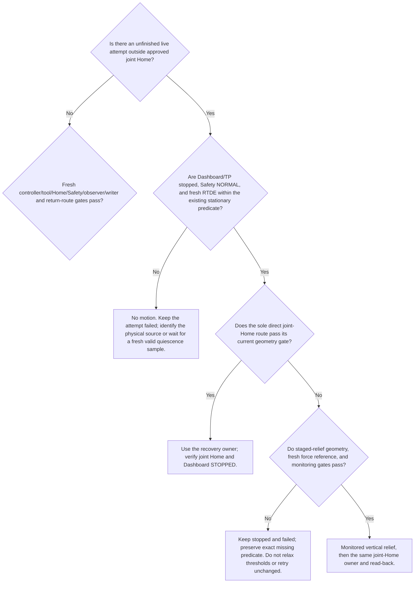

# TASE 5 N precision — binary decision tree

This is the active decision record for recovering and improving TASE-RNN 5 N normal-force accuracy. It keeps the short-EOAT RPSFC/SFC/DSFC drift experiment separate. Each failed attempt remains a failure and retains its original denominator.

```mermaid
flowchart TD
    A{"Fresh controller, short-EOAT installation/TCP/payload, approved joint Home, Safety, observer, one writer, fetched-back package, and verified return route?"}
    A -- No --> A0["No motion. Record the exact missing predicate; continue independent offline work."]
    A -- Yes --> A1{"Does the fresh TP enter PLAYING and echo runtime identity 27/618001 before timeout?"}
    A1 -- No --> A10["No ARM/contact/PATH. Fix the confirmed URScript compile defect, validate a new package in isolated URSim, then recheck the physical TP start before motion."]
    A1 -- Yes --> B{"State 20 contact search with current 8 mm early-brake package passes without force/travel/timing guard?"}
    B -- No --> B0["Recover to the same joint Home. Identify the first force/travel/speed condition; do not repeat the same failed branch unchanged."]
    B -- Yes --> C{"After the 8 s ramp, does the actual 0.5 s PATH-entry conjunction open?"}
    C -- No --> C0["Preserve the failed attempt and first failing conjunct. Replay force, freshness, TCP/joint stationarity, torque and Safety; do not call this a 10 s hold failure."]
    C -- Yes --> D{"Full 60 s PATH, 550/550 [5,60) bins, and all raw host/RTDE/Kunwei/TP-consumed layers >=460 Hz?"}
    D -- No --> D0["Keep any measured MAE as labeled diagnostic data; recover Home and inspect the first deficient layer or missing PATH interval."]
    D -- Yes --> E["Seal one A unit: Md=9.565272137974492, Bd=693.6559295653944, integral=1.0 N·s; report contact, 0–60 s, and formal [5,60) separately."]
    E --> F{"Does a second same-condition A unit reproduce the contact gate, rate floor, full path, and score range?"}
    F -- No --> F0["Keep both outcomes in the denominator; diagnose the first differing contact/timing/measurement factor before any controller comparison."]
    F -- Yes --> G{"Are per-frame normal error, integral, single/double saturation, actual q/qd, dt, host publish, RTDE and TP echo joined and complete?"}
    G -- No --> G0["Repair telemetry capture and validate it offline; do not infer windup from the terminal integral alone."]
    G -- Yes --> H{"Do force-frame/baseline/coordinate or sensing effects explain the error?"}
    H -- Yes --> H0["Correct only the demonstrated measurement/execution issue; KWR75 remains feedback, not independent task-force truth."]
    H -- No --> I{"Do integral growth, state/authority clamp, output saturation, slew, or rollback explain the error?"}
    I -- Yes --> I0["Compare one integral/anti-windup change at a time with path gains frozen and complete matched paths."]
    I -- No --> J{"Does a measured local second-order model fit the 5 N normal axis?"}
    J -- Yes --> J0["Estimate effective M, then compare zeta 0.5, 0.707 and 1.0 using either B=2*zeta*sqrt(M*K) or K=B^2/(4*zeta^2*M)."]
    J -- No --> J1["Report where the model fails and use a bounded independent normal K/B grid; do not reuse tangential Bd or stiffness."]
    J0 --> K["Next: TASE-QP, first offline and with the frozen A operating point."]
    J1 --> K
    K --> L["Then: SFC+TASE with tangential projection and one final joint-velocity realization."]
    L --> M{"Does a candidate pass 5 matched complete A/candidate pairs at >=460 Hz?"}
    M -- No --> M0["Retain failures and diagnose; allow up to 10 pairs only when the first five are near the evidence threshold."]
    M -- Yes --> N{"Mean MAE improvement >=0.10 N and paired 95% CI lower bound >0?"}
    N -- Yes --> N0["Report an evidenced improvement, with KWR75 truth limitation and the full failure denominator."]
    N -- No --> N1["Report no established improvement; retain A or the best supported method."]
    N0 --> O["Only after the archive/capacity gate: bounded online learning candidates between episodes, never inside the live real-time loop."]
    N1 --> O
```

## Historical branch position (checkpoint before R31 rate460)

The following section records the earlier September 25 checkpoint. The later
R31 rate460 A and TASE-QP observations are recorded below and supersede its
current-status statements; no earlier failure or metric is deleted.

- **Latest branch: A → Yes → A1 → No.** At 13:09 HKT the no-motion r27 start-check got Dashboard Load=`Loading program ... codex_eoat_probe_20260925_r2.installation` and Play=`Starting program`, but all 117 observed Dashboard snapshots stayed STOPPED and all 717 RTDE samples stayed `runtime_state=1`. No revision-27 TP identity was observed; only stale `(606006,25,618001)` / state90/reason58 registers appeared. They do not establish a new physical TP fault reason.
- The preceding formal A attempt also stopped before contact qualification and PATH with the same `PLAYING` timeout. Both attempts issued zero host motion commands; the second 10 s start-check issued no ARM or PATH. Joint Home and Dashboard STOPPED/Safety NORMAL were freshly verified. Neither run has a force MAE.
- Required video was available during the no-motion check; it did not trigger the failure. A digest-pinned isolated URSim test loaded the same r27 triplet and Installation. After its simulator-only power recovery, Dashboard acknowledged Play as `Starting program` but the TP stayed STOPPED with zero simulated motion. The simulator's `/ursim/URControl.log` recorded `Compile error: name 'abs' is not defined`; the fetched-back `.urp` cache exactly matches the `.script` and both contain `local vertical = abs(speed[2])`. The source helper `codex_r006_abs` already exists, so this is a concrete generated-URScript defect and a strong candidate explanation for the physical symptom. The real controller itself did not expose that compiler event; keep the physical causal link as **probable, not yet directly observed**. The code fix, r28 rebuild and isolated start check are pending before the next physical start. Evidence: `runs/tase-r27-start-check-20260925T1309HKT/ursim-r27-start-logprobe.json`, `runs/tase-r27-start-check-20260925T1309HKT/supervisor-result.json`, and `runs/tase-r27-baseline-prep-20260925T1329HKT/software_baseline_receipt.json`.

- Two live A units now completed full 60 s PATHs and 550 formal bins with fresh joint-Home and STOP evidence. Their formal bin-mean MAEs are **1.172493 N** and **1.269608 N** (mean 1.221050 N). With `n=2`, do not infer repeatability or treatment effect.
- State 20 passed on both attempts using the fresh 8 mm package. State 21's actual gate is the 8 s ramp followed by a distinct 0.5 s continuous `PathEntryReleaseGate`; there is no active 10 s hold. The old rate400 reason-48 failure held the complete predicate 0.267 s. The two successful A attempts held it **0.540 s** and **0.501621 s**. Keep the gate unchanged; the second pass had only 1.6 ms margin.
- The older runtime readiness counter and the later joint-release diagnostic remain historical receipt fields, not the current release rule.
- The second A's raw host/RTDE/TP echo/Kunwei rates were **499.2/499.1/480.0/999.98 Hz**. Every raw layer passed 460 Hz. The synchronized accepted-row rate was 480.0 Hz and is not a raw-layer frequency.
- The sealed v2 command trace is complete for all **29,950** rows. The 1.0 N·s integral state was at least 98% of its limit for **11.6%** of ticks; task-space saturation feedback was active on **30.6%** of ticks. These observed events motivate an offline anti-windup replay but do not prove causation. Final realization saturation and host slew each occurred on only 16 ticks.
- Timing met the rate floor but had a **19.674 ms** maximum host observation gap and **19.757 ms** publish gap. At the largest gap, measured provider and solver execution totalled about 1.26 ms, so those computations do not explain the full wait. Upstream cause is still unknown. Freshness passed by only about 0.33 ms.
- Same-input CPU/GPU replay on all **29,950** sealed rows produced a maximum command difference of `4.62e-9 rad/s`. CPU median solve time was **0.0525 ms**, GPU **0.0671 ms**. GPU therefore does not explain or fix the long host gaps; live backend remains CPU.
- The sensor frame counter confirms **999.98 parsed Kunwei frames/s**, but the transport returns only the newest wrench from each batch. The host consumes/publishes at about **499 Hz**, and the sealed JSON trace does not retain all values in the 1 kHz batches. There is no evidence yet that 1 kHz input improves filtering or force estimates.
- The fixed-error integral replay exactly reproduced A's 1.0 N·s state. It places B's 0.5 N·s legacy cap at mean absolute state **0.278 N·s** versus A's **0.594 N·s**. The conditional/double-clamp D replay had **0.388 N·s**, but reused A's saturation signs and did not recompute D's outputs. None of these fixed-input replays estimates force MAE.
- The natural-excitation model audit from both A paths did not identify a valid local 5 N second-order model: K-only force/position `R²` was about **0.002–0.005**, and K/B/M values changed sign or scale with smoothing and PATH half. Do not derive zeta values from that fit. Keep an independently named K/B grid offline until a local model or discussed live candidates exist.
- Current next offline branch: prepare a bounded local identification protocol and assess sensor-batch retention needs. First live integral comparison, when the candidate/recovery gates are fresh, is A versus B with every other parameter frozen; D stays offline until its final-output feedback is recomputed from D commands.
- Continue with offline scheduler/communication attribution and CPU/GPU solver benchmarking while no live writer exists. Keep Kunwei's ~1 kHz acquisition distinct from the 500 Hz controller/460 Hz acceptance layers. Next live methods remain gated on explaining the measured trace and validating each one-factor candidate offline.
- A/Candidate confirmation requires full 60 s, each required raw layer >=460 Hz, mean MAE improvement >=0.10 N, and paired 95% CI lower bound >0. Failures remain in the denominator. KWR75 feedback is not independent task-force truth.

## R31 rate460 and TASE-QP branch — 16:15 HKT

- Fresh current R31 A attempts at 15:10 and 15:30 HKT both completed 60.0 s,
  550/550 formal bins, passed the 460 Hz timing gate, and returned to verified
  joint Home with Dashboard STOP. Formal MAE was **1.282720 N** and
  **1.006797 N**. The two values are descriptive with n=2; neither establishes
  a treatment effect. Their trace comparison remains in
  `reports/tase_r31_a_repeat_trace_comparison_20260925.json`.
- The requested short TASE-QP scheduler attribution replayed one sealed
  35-iteration input 30,000 times with live-writer-style GC disabled. Solver
  time median was **0.03195 ms**, maximum **0.04601 ms**; zero solves exceeded
  the frozen **1 ms** deadline. The prior **106.1 ms** event was not reproduced
  and remains unexplained. The earlier 1.4–1.5 ms probe spikes were caused by
  the diagnostic harness with GC enabled and per-sample object allocation;
  retain that run as a harness artifact, not controller evidence.
- First rate460 TASE-QP attempt used the previously frozen BO-10/B profile
  (`Md=8.592660`, `Bd=772.147372`, integral **0.5 N·s**). It executed a complete
  **60.006 s** PATH with 550 bins, timing passed at **481.1 Hz** effective
  writer/echo rate, and all **29,997** QP solves passed (maximum **0.0926 ms**).
  It was ineligible because published-versus-actual joint-velocity
  correlation was **0.840132 < 0.900**. Its **0.914710 N** MAE is diagnostic,
  not a formal controller score. Recovery verified joint Home and STOP.
- A matched rate460 QP attempt then held the R31 A outer profile fixed
  (`Md=9.565272`, `Bd=693.655930`, integral **1.0 N·s**) and changed only the
  inner solver. It completed **60.004 s**, 550 bins, and passed timing at
  **480.05 Hz**; all **29,957** QP solves passed with maximum **0.1001 ms**.
  Its motion gate still failed at correlation **0.848607 < 0.900**. The
  **0.950139 N** MAE is diagnostic only. The exact same-consumed-packet replay
  reproduced **0.848627**; shifting the association by one packet reached only
  **0.852176**. Joints 2, 4, and 5 correlations were **0.705**, **0.880**, and
  **0.086**, respectively. The two RNN A controls passed the same gate at
  **0.9701** and **0.9721**. This is a matched live method observation, but the
  QP attempt remains a failure because actual-velocity tracking did not meet
  the frozen gate.
- Neither QP attempt had a safety, Home, frequency, or solver-deadline failure.
  Do not relax the **0.900** motion gate or report either diagnostic MAE as an
  eligible BO observation. Both failed attempts remain in the denominator.
- The second QP setup failure (`TASE_QP requires the sealed bo-10 candidate
  identity`) occurred before ARM or host motion publication; it is preserved
  separately. The live writer now accepts exactly the prior BO-10/B profile
  or the rate460 R31-A profile for a matched solver comparison. All other
  candidate identities and altered values remain rejected before Dashboard
  Load/Play.
- Next: complete offline per-joint command/actual-velocity diagnosis and the
  SFC+TASE composition replay. Keep SFC gains and the final joint-velocity
  realization fixed to their approved records. No SFC+TASE live run is inferred
  from this QP result.

## Historical recovery decision branch — 09:30 HKT

While a prior live attempt is outside joint Home, recovery precedes the next experiment:

The current event is at **S → No**. Fresh preflight showed Dashboard STOPPED and Safety NORMAL, but a 5.01 s RTDE capture had only 17.3% frames passing the exact stationarity predicate and a longest continuous pass of 9.5 ms. The corrected recovery owner therefore dispatched no motion. The first invocation's missing `AMENT_PREFIX_PATH` was fixed; the next owner invocation reached and failed the actual stationarity check. Do not invoke it again unchanged. Resume only after the physical condition changes or new evidence supports a different safe recovery diagnosis. The stale baseline recaptured below the Home clearance height is not accepted as no-contact evidence.

The first integral pair is incomplete: B (`0.5 N·s`) is one eligible full-path observation at **1.272056 N** formal MAE and **465.783 Hz** minimum rate layer with verified Home; subsequent A (`1.0 N·s`) reached 60.002 s / 29,954 formal command rows but TP stopped at `reason=58 return_guard=0`, with no certified path completion or Home. Keep that A attempt failed and do not report a paired integral comparison.

The latest TP read-back narrows A's failure: the 60 s formal PATH ended and emitted `state=40`; the subsequent 250 ms stationary dwell failed with reason 58 before any return guard was set. The TP's own fault path then retried the same bounded return but could not establish its stationary start condition. Do not classify this as a State-20/21 contact-release failure or an integral-policy result. The separate host recovery's current stationarity gate also remains unmet.

A sealed v2 timeline may still support labeled diagnostics when a failed receipt omits its PATH start. The reducer now infers only the clock origin from `host_monotonic_s - reference_time_s`; it does not synthesize lifecycle completion, Home, eligibility, or an official score. Focused reducer tests pass 2/2.

## Current branch — 16:54 HKT

- **Power state:** fresh read-only preflight confirms the robot is already powered, Safety NORMAL, TP STOPPED, and within `2.9e-5 rad` of the approved joint Home. No Power On command or motion was sent.
- **TASE-QP:** both 60 s attempts still fail the frozen `actual_qd` correlation threshold `0.900`; measured values are `0.840132` and `0.848607`. Keep them as failures and do not rerun unchanged.
- **SFC/DSFC:** the R31-parameter-aligned offline proxy is complete (30/30, five blocks × three scenarios × two laws). Under the proxy, mean paired DSFC-minus-SFC model MAE is `+0.0000021 N` on plane, `+0.0003143 N` on tangent pulse, and `+0.0082936 N` on normal pulse. This is not a physical outcome. The `120 N/m` path-stiffness setting remains a model-only value, and no live composed method is registered.
- **Next branch:** resolve the QP joint-velocity mismatch and prepare a separately reviewed live SFC+TASE identity/parameter binding; keep the motion gate unchanged.

## QP motion mismatch follow-up — 2026-09-25T17:01:55+08:00

- A wider ±24-packet scan did not reveal a causal lag repair: the best flattened QP correlation was `0.852176` at offset `−1` (future command), and J2/J4 peaks remained `0.709` / `0.889`.
- The QP sealed command trace has higher J2/J4 setpoint-change rates and more host slew / output-feedback realization-limit flags than either RNN baseline. This is a plausible proximal mechanism, not proven root cause.
- Keep live QP stopped at the failed eligibility branch. Next offline work: relate QP active-set changes and final `Jqdot` shortfall to subsequent RTDE qd rows. Do not relax the `0.900` threshold or repeat the same live profile.
