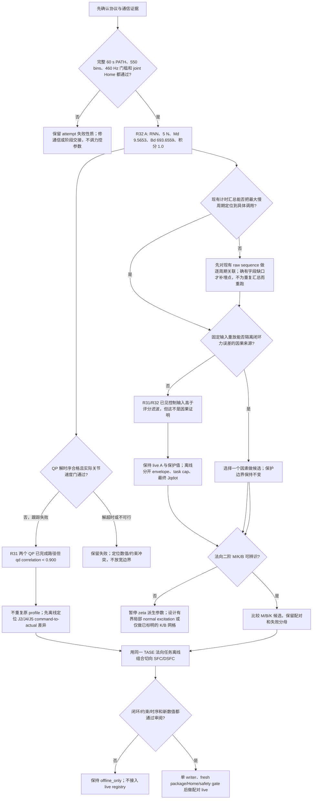

# TASE 力控精度研究决策树（2026-09-26）

本树记录已观察到的分支与当前可执行下一步；它不是实机授权或完成结论。RPSFC/SFC/DSFC 静止漂移实验与 TASE 接触力误差分开处理。

## 当前证据账本

| 分支 | 已有 evidence 与身份 | 当前结论 | 缺口 / 下一步 |
|---|---|---|---|
| RNN A 基线 | [R32 A attempt](../runs/tase-r32-rate460-a-v3-capture-evidence-only-20260926T171700HKT/attempts/0001/)：`TASE_RNN_MATURE`，Figure-eight `r013_60_rate460`，60.0 s，550/550 bins，5 N，`Md=9.565272137974492`、`Bd=693.6559295653944`、integral `1.0 N·s`，TP consumed 480.936 Hz，joint Home verified。 | 正式 `[5,60)` MAE `1.098445 N`；同次 `[0,60)` feedback sample MAE `1.126476 N`。这是真实完整 A 单元。 | Kunwei feedback 不是独立 task-force truth。继续保留 sensor channel、force norm 和 normal force 的口径边界。 |
| RNN A force input 与运动实现 | [R31/R32 channel alignment](tase_r31_r32_force_channel_alignment_20260926.md) 与 [R32 force-to-motion chain](tase_r32_signal_to_motion_chain_20260926.md)：四个完整 A 圈中 `max(filtered, measured)` 比评分滤波高 `0.808–1.020 N`；R32 task normal cap 事件占 `22.60%`；final `Jqdot` 的 normal task-command residual p95 `2.802 mm/s`。 | 重复出现的信号差、速度限制和最终实现残差已被观测到。固定输入滤波反事实改变命令，但不产生闭环 MAE，不能分配它们对误差的因果份额。积分状态到 cap 的比例为 `7.03–10.32%`，单凭此不能判定 windup。 | 不改力输入 envelope、不提高速度上限、不改积分或求解器。先把 R32 最大 host 间隔与保存的 RTDE/Kunwei/command sequence 关联，再离线逐个拆 envelope、task cap、final `Jqdot`。 |
| RNN 命令复算 | [R32 output/slew replay](tase_r32_rnn_output_slew_replay_20260926.md)：29,989 sealed ticks；host slew 限幅 11 tick。 | 旧 replay 的差异来自把 slew 错写成 `scale*qdot`；运行式是 `previous + scale*(qdot-previous)`，修正后 29,989/29,989 匹配。无需因这 11 tick 改控制器。 | 该结果只验证本地实现/packet mapping，不证明论文方程或 slew 对 MAE 的因果效果。 |
| R32 分层时序 | [R32 A attempt timing attribution](../runs/tase-r32-rate460-a-v3-capture-evidence-only-20260926T171700HKT/attempts/0001/attempt-result.json)、`command_timeline.jsonl` 与 `robot_frames.jsonl`。 | PATH 最大 host interpublish 在 `sequence 36485→36486`：`11.891 ms`；`actual_dt=12.068 ms`。RTDE host observation 相隔 `12.059 ms` 后恢复，并一次 drain 六帧；controller timestamps 从 `187011.837` 到 `.847` 连续、每 `2 ms` 一帧，TP consumed `480.936 Hz` 高于 `460 Hz`。因此此处已定位为 host-side observation/control-loop gap；RTDE 仍持续生成并缓冲帧。该 attempt fresh-gap 最大 `12.068 ms`，低于 `20 ms` admission 上限。state21 有另一次 control-step wall `10.963 ms` / thread CPU `1.373 ms`；PATH state25 control-step 最大 `1.962 ms`。RTDE poll wall 最大 `1.178 ms`、没有 `poll_not_ready` 或 poll 超过 `2 ms`；provider `1.044 ms`、solver `0.091 ms`、publish latency `1.654 ms`、input send 最大 `0.042 ms`、socket `sendall` 最大 `0.027 ms`。 | 已排除“UR RTDE 没有产帧”以及单次 solver/socket-send 本身耗时足以解释该 host gap；尚未从此批摘要确定主机在哪个具体 wait/scheduler/call boundary 丢掉这约 `12 ms`，也不能把它进一步断言为 network 或 Linux scheduler 根因。state21 outlier 与 PATH 慢周期不是同一事件。 | 先审计现有 loop、select/sleep 与 poll 调用顺序，把已定位的 host gap 对应到具体未计时区段；只有当前日志确实缺该 boundary 时再补埋点。不要为重复采集相同聚合摘要而重跑一圈。 |
| 五策略积分筛选 | [25-attempt screening result](../runs/tase-r31-integral-screening-20260925T1825HKT/screening-results.json)：rate460、5 N、固定 `Md=9.565272137974492` / `Bd=693.6559295653944`，25 次全部封存、session closed。 | `complete/5` 与成功圈 `[5,60)` MAE 均值：A `4/5, 0.977 N`；B `3/5, 1.140 N`；C `4/5, 1.756 N`；D `4/5, 1.235 N`；E `5/5, 1.929 N`。总计20完整、5失败；四次因 rate gate、一次 PATH 为 `59.996 s` 未达60 s。四次 rate-only failure 在各自方法下的 writer/RTDE/TP 速率完全一致（`380.1–459.1 Hz`），Kunwei仍为 `1000 Hz`；它们的 host publish 间隔 p95 为 `2.617–4.496 ms`、最大 `7.265–10.577 ms`。四个慢周期对应的 provider耗时 `0.780–1.066 ms`、solver `0.068–0.131 ms`、publish latency `1.242–1.799 ms`；没有逐阶段记录可解释间隔中的其余等待。rate failures 的 550-bin 诊断 MAE 分别为 C `1.924 N`、A `1.097 N`、D `1.288 N`、B `1.236 N`，均不进入 formal objective。筛选文件的预定规则为 complete count 优先，所以选中E；这表示可靠完成次数最高，不是力误差最好。screen-D-00 的 sealed runtime 绑定 `conditional-double-clamp-v1`，最终发布反馈在该圈29,994/29,994行有记录，其中4,833行冻结 final-output 积分增量。 | 速率证据将失败定位到 host publication/control-cycle availability 这一层，尚不能指认未计时 wait 的具体调用或归因为 scheduler/network。该筛选是小样本描述，不证明统计优胜；A有最低 MAE，E有最高完成数。A/B另有10个完整配对的单独报告，不与这25圈合并。 | 对E按冻结规则做24次 resident autotuner并完整保留 rate failure；利用新 attempt 分层计时继续定位缺失的 host wait。末尾与A incumbent作五轮配对确认。只有live timing资源lane空闲及fresh observer/Kunwei/TP gate通过后才启动。 |
| QP inner solver | [R31 QP comparison](tase_r31_qp_motion_gate_comparison_20260925.md)：BO-10/B 和 matched-A 两圈均为 rate460、完整 60 s、550 bins；solver max `0.0926/0.1001 ms`，无 >1 ms solve。 | 正式 motion gate 是 consumed-sequence `corr(command, actual_qd) >= 0.900`。两圈仅 `0.840132/0.848607`，所以 MAE `0.914710/0.950139 N` 都是诊断数据；失败集中在关节跟踪差异，不能以低 MAE 宣称优胜。 | 不重跑同一 QP profile。先查逐关节 command→target_qd→actual_qd 及 final slew 对应，尤其 J2/J4/J5；硬 equality、joint/slew 保护和 1 ms deadline 保持不变。 |
| QP scheduler outlier | R31 报告记录 30,000 次离线 solve 最大 `0.04601 ms`；两次 live solve 最大均低于 `0.11 ms`。旧 106.1 ms 未重现；GC-enabled harness 曾自生 1.4–1.5 ms spikes。 | 证据不支持把两次 live QP 跟踪失败归因于 solver deadline；旧 106.1 ms 根因仍未知。 | 新调度试验必须与共享 CPU/I/O 负载隔离，不能把旧 outlier 或 host 周期误当作 controller solve 时间。 |
| 法向 M/B/K | [R32/R31 normal-axis identifiability](tase_normal_axis_model_identifiability_20260925.json)：自然 Figure-eight closed-loop force-vs-position 拟合中 `K-only R²` 近零，M/K/B 符号和量值随平滑窗、半程明显变动。 | 当前数据不能识别 5 N 工作点的有效法向 M、K、B；不支持从 `zeta=0.707` 推导 live 参数。 | 设计独立、有界的局部法向响应激励；具体位移/速度/持续时间/停线必须先绑定保护与审批。若不可辨识，只可做显式 K/B 网格，不称作二阶模型辨识。 |
| SFC/DSFC + TASE | [R32 sealed trace replay](tase_r32_live_trace_controller_replay_20260926.json) 用同一 RNN feedback trace 对 SFC/DSFC 做 open-loop counterfactual；每 tick 只做一次最终 joint realization，未使用真实曲面或 task-force 真值。当前 [composed adapter](../tools/tase_sfc_composed_adapter.py) 和注册角色仍标为 offline。 | 组合接缝可以离线复算；它不构成闭环力控结果或实机改善。默认 `120 N/m` path stiffness 是离线参数，不是 live-approved。 | 保持 TASE 法向/姿态优先；SFC/DSFC 只供切向任务，并经同一 final solver。补齐同 R32-A normal identity 的 replay、约束与误差敏感性；所有新 live stiffness/law 参数先列数值、单位、来源、作用和 replay。 |

对上述四次 rate-only 失败作阈值敏感性核算：若只用 `400 Hz` 替换 rate floor，其中 `425.4/459.1/423.4 Hz` 三次会越过频率门槛，`380.15 Hz` 仍会失败。它只说明 cutoff 会改变录取数，不构成这些 attempt 通过独立 `rate400` 协议的证据；rate460 与 rate400 不得混作配对结果。

## 当前研究选择

1. 已通过的 R32 A 与 no-motion resident start-check 保留为当前安全/性能基线；resident check 不算新的 force-control attempt。
2. QP 的旧 profile 已有两个完整但 motion-gate-failed 的实机结果，不再无变化复跑。保持门槛与 bounds，先完成 per-joint 实际速度链路诊断。
3. M/K/B 不可辨识分支不做 `zeta` 派生 live sweep。SFC+TASE 继续 offline-only，直到组合误差、实际步长积分、参数身份与 live gate 均闭合。
4. 在线学习仍等待 Google Drive 归档/容量证明；它不能和 live writer 并行，也不能跳过相同物理门槛。
5. R32 原始圈已通过聚合速率门槛，并且 attempt receipt 已含逐阶段计时摘要。raw join 已把最大 PATH 间隔定位到 host observation/control-loop gap：RTDE buffered timestamp 连续，而 host 隔约 `12 ms` 才再 poll/使用；具体未计时的等待边界仍未知。先审计 loop 与 poll/sleep 调用顺序，缺字段时才补埋点。代码层 marker lifecycle focused suite 已 **101 passed**；修复仅保留已有 baseline 成功计数，提交 `29796f5f`。
6. [Power-on resume checkpoint](tase_poweron_resume_checkpoint_20260926.md) 记录机器人已上电、程序 STOPPED、joint Home、R31 TP triplet fresh read-back 和一张 OctoStream frame；它是只读检查点，不是新 attempt。Kunwei fresh baseline 和连续 observer 仍须在下一圈前建立。
7. 五策略筛选已经25/25封存，当前选择 E 是按完成数优先的既定规则，不等同于 MAE 优胜。`figure8.sh --autotune` 旧实现会忽略这项选择、硬编码 A；现已改为默认接续 E，A须显式配置和提供完整基线 receipt，`--resume` 读取 campaign 冻结配置。Focused entry tests **24 passed**；正式24-unit tuner campaign 尚未启动。

最近 offline SFC+TASE 验证：`test_tase_sfc_composed_adapter_timing.py`、`test_tase_live_trace_sfc_dsfc_replay.py`、`test_contact_method_registry.py` 共 **22 passed**。验证覆盖观测间隔按不超过 4 ms 的零阶保持子步积分，超出 freshness bound 拒绝，以及注册身份仍属 offline；它不构成 live acceptance。

当前若需任何正式 live timing acquisition，仍受共享资源 lane 限制：2026-09-26 20:11 HKT 无关 archive compaction 进程仍占用一个 CPU 核并写入外部盘。保留其运行控制权；在它结束前完成代码路径审计和离线 trace 分析，之后再 fresh-check 是否仍需要 live 采集。
